# 기능별 내부 로직 구조도

_기준: 2026-10-23 · 커밋 `da011b7` + 버그 3건 수정분_

> 이 문서는 **"지금 코드가 실제로 어떤 순서로 도는가"** 다.
> **왜 그렇게 짰는지**는 [`ARCHITECTURE.md`](ARCHITECTURE.md), **확정 사항**은 [`DECISIONS.md`](DECISIONS.md),
> **화면 흐름**은 [`FLOW.md`](FLOW.md)에 있다. 수치는 적지 않는다(전부 인스펙터/SO 에셋).
>
> - 그림 원본: [`logic_map/LOGIC_MAP.drawio`](logic_map/LOGIC_MAP.drawio) — draw.io(데스크톱/웹/VS Code 확장)로 열어 고친다. 페이지 하나가 그림 하나.
> - 그림 파일: [`logic_map/png/`](logic_map/png/)
> - 같은 내용의 Word 판: [`LOGIC_MAP.docx`](LOGIC_MAP.docx)
> - 경로는 `Assets/_Project/Scripts/` 기준.

## 그림 읽는 법

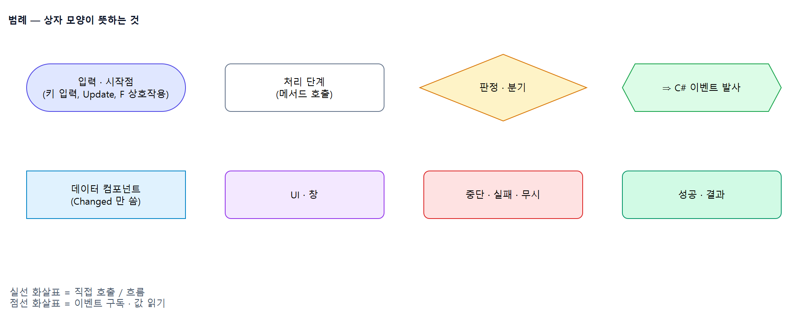

## 목차

0. [한눈에 보기](#0-한눈에-보기)
1. [입력과 행동 판정](#1-입력과-행동-판정)
2. [이동 · 조준 · 대시](#2-이동--조준--대시)
3. [좌클릭: 채집 / 차지 / 공격](#3-좌클릭-채집--차지--공격)
4. [채집 보상 → 드랍 → 줍기](#4-채집-보상--드랍--줍기)
5. [몬스터: AI · 공격](#5-몬스터-ai--공격)
6. [피해 처리](#6-피해-처리)
7. [능력치 합산](#7-능력치-합산)
8. [아이템 · 인벤토리](#8-아이템--인벤토리)
9. [F 상호작용과 스테이션](#9-f-상호작용과-스테이션)
10. [E 키: 소모품 / 블럭 설치](#10-e-키-소모품--블럭-설치)
11. [성장: 레벨 · 스킬](#11-성장-레벨--스킬)
12. [구역](#12-구역)
13. [저장 / 불러오기](#13-저장--불러오기)
14. [UI 라우팅](#14-ui-라우팅)
15. [오브젝트 풀](#15-오브젝트-풀)
16. [이벤트 구독 목록](#16-이벤트-구독-목록)
17. [정리하다 발견한 것](#17-정리하다-발견한-것)

---

## 0. 한눈에 보기

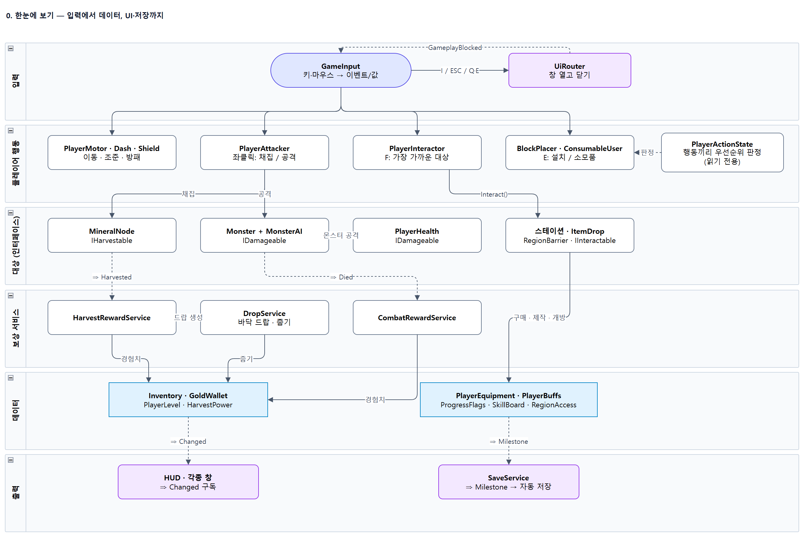

**규칙 세 줄**

1. 입력은 `GameInput` 한 곳에서 나오고, 창이 열리면 `GameplayBlocked` 하나로 게임 입력이 전부 끊긴다.
2. 행동끼리의 우선순위(넉백 중엔 공격 불가 등)는 `PlayerActionState`가 **읽기만 해서** 판정한다. 서로 직접 호출하지 않는다.
3. 데이터 컴포넌트는 `Changed`만 쏘고, UI와 저장은 구독만 한다. 저장 시점은 각 시스템의 `Milestone` 이벤트가 정한다.

---

## 1. 입력과 행동 판정

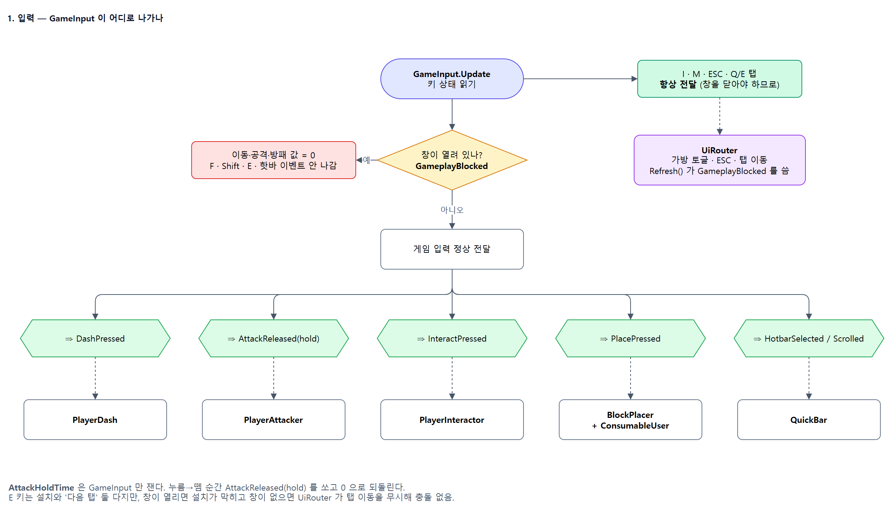

- InputAction은 **에셋 없이** `GameInput.Awake`에서 코드로 만든다.
- 키: WASD 이동 · LMB 공격 · RMB 방패 · LShift 대시 · F 상호작용 · I 가방 · M 지도 · ESC 취소 · E 설치 · Q/E 탭 · 1~9/휠 핫바
- `GameplayBlocked`를 쓰는 곳은 `UiRouter` 하나뿐이다.

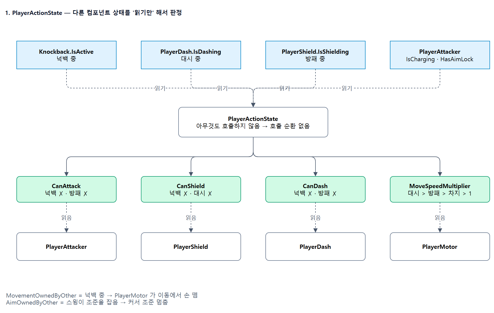

---

## 2. 이동 · 조준 · 대시

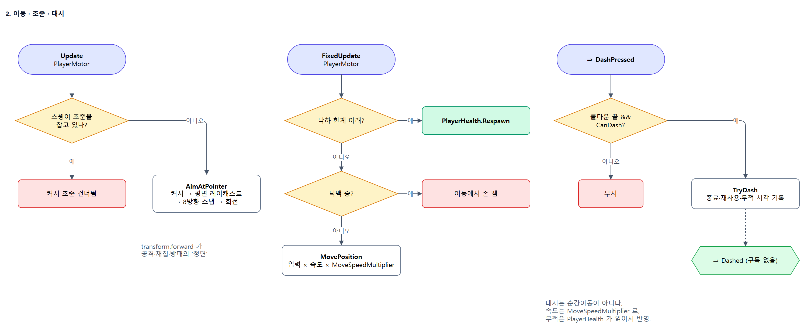

- `transform.forward`가 공격·채집·방패 판정의 "정면"이다.
- `CameraRig`는 `LateUpdate`에서 프레임 독립 지수 보간으로 따라간다(회전 고정).
- `GroundLock`은 Rigidbody의 Y를 매 FixedUpdate 고정한다(`Release(초)`로 잠깐 풀 수 있음).

---

## 3. 좌클릭: 채집 / 차지 / 공격

`PlayerAttacker` 하나가 좌클릭 전부를 맡는다.

### 3-1. 누르는 동안

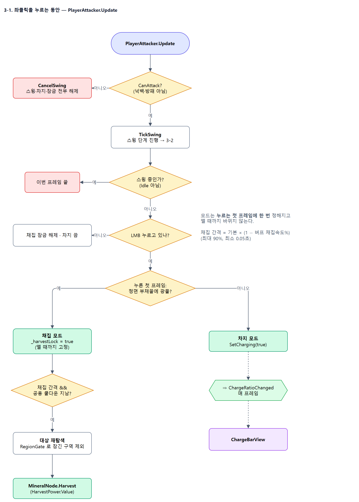

### 3-2. 뗄 때와 스윙

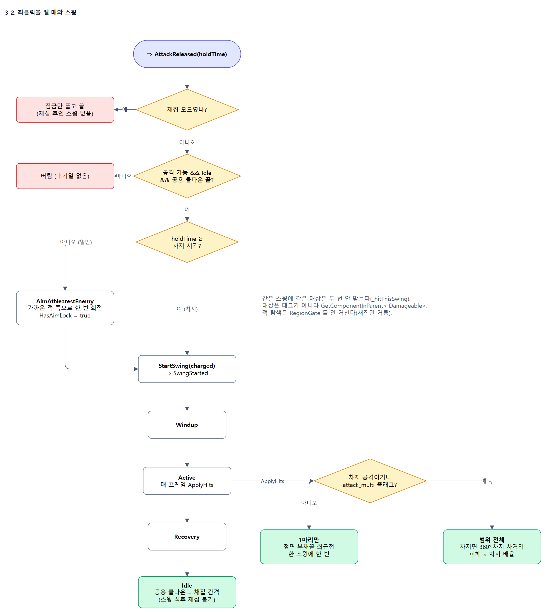

**방패** — `PlayerShield.Update`는 `ShieldHeld && CanShield`가 바뀔 때 `IsShielding`만 갱신한다.
실제 막기 판정은 피해를 받는 쪽(`PlayerHealth`)이 한다 → [6절](#6-피해-처리).

---

## 4. 채집 보상 → 드랍 → 줍기

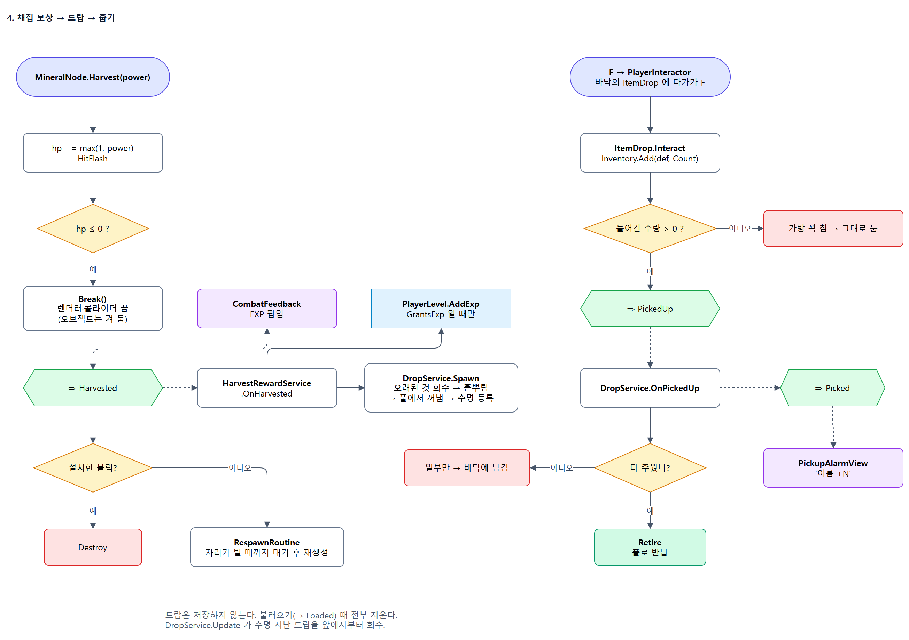

- 설치한 광물 블럭은 `MarkAsPlaced()`로 **경험치 없음 · 재생성 없음 · 캐면 파괴**가 된다.
- `DropService.GiveOrDrop`: 인벤에 넣고 넘친 만큼 바닥에 드랍. 제작 완료·취소 반환에 쓴다.

---

## 5. 몬스터: AI · 공격

몬스터 한 마리 = **에셋 4종(정의 · 공격 · 패턴 · 상태) + 컴포넌트 3개** (2026-10-26 재설계 — 자세한 그림은 `docs/MONSTER_AI_DESIGN.html`)

- `MonsterDefinition`(SO) — 수치, 공격 목록(순서 = 우선순위), 패턴, 넉백·경직·복귀 회복, 색. 상태 없음
- `MonsterPattern`(SO) — 칸(추적·예고·빈틈·쿨다운 대기·후퇴)마다 어떤 상태 에셋을 쓸지. 상태 에셋도 무상태 SO
- `MonsterAttack`(SO) — `CanUse` / `Execute` / `TickMotion`. 몹별 하나씩 + 공용 `ContactAttack`. 상태 없음
- `Monster` — 체력, 생사, 피격, 재생성, 회복
- `MonsterAI` — 실행기: 가드 → 방해 처리 → 어그로 → 상태 실행 → 전환. 공통 부품 `MonsterMemory`·`MonsterMotor`·`MonsterAggro`
- `Knockback` — 밀려나는 동안의 위치 (세기·시간은 정의에서)
- 구역 전투 초기화 — `RegionCombatReset`(씬 GameState): 사망 → 즉시, 구역 이탈 → 걸어서 복귀·회복

생성·재생성

- 지금 몬스터는 **씬에 미리 배치**된 것이다. `MonsterSpawner`를 부르는 코드는 없다([17절](#17-정리하다-발견한-것)).
- `Monster.Start`에서 `HomePosition`을 기록한다(`GridPlacement`가 `OnEnable`에서 위치를 맞추므로 `Start`).
- 저장은 `MonsterDeaths`가 죽어 있는 몬스터의 **칸 좌표**만 남긴다.

### 5-1. AI 우선순위

> ⚠️ 아래 그림(`08_monster_ai.png`)은 재설계 전 if 사다리다. 지금 흐름은 `docs/MONSTER_AI_DESIGN.html` 3·4장을 본다.

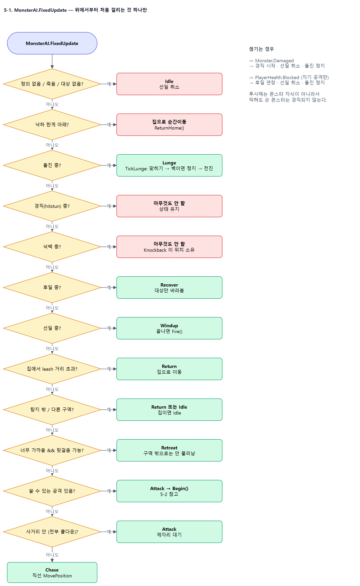

### 5-2. 공격 한 번

> ⚠️ 그림의 공격 클래스 이름·돌진은 재설계 전 기준이다. 공격은 몹별 클래스로 나뉘었고 임시 돌진은 폐기됐다.

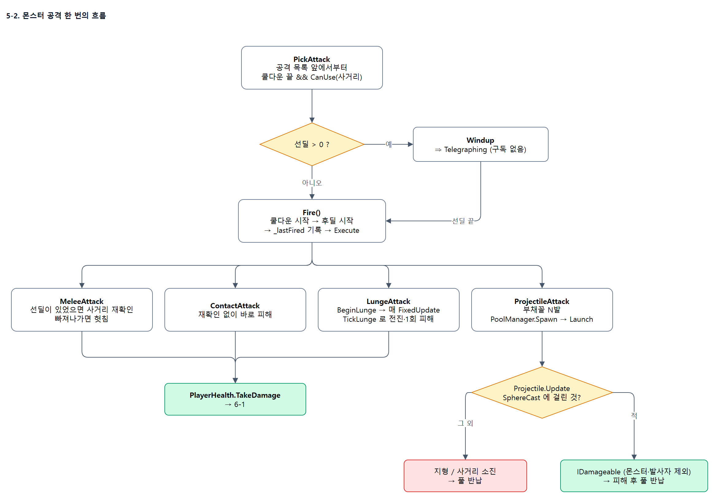

---

## 6. 피해 처리

### 6-1. 플레이어가 맞을 때

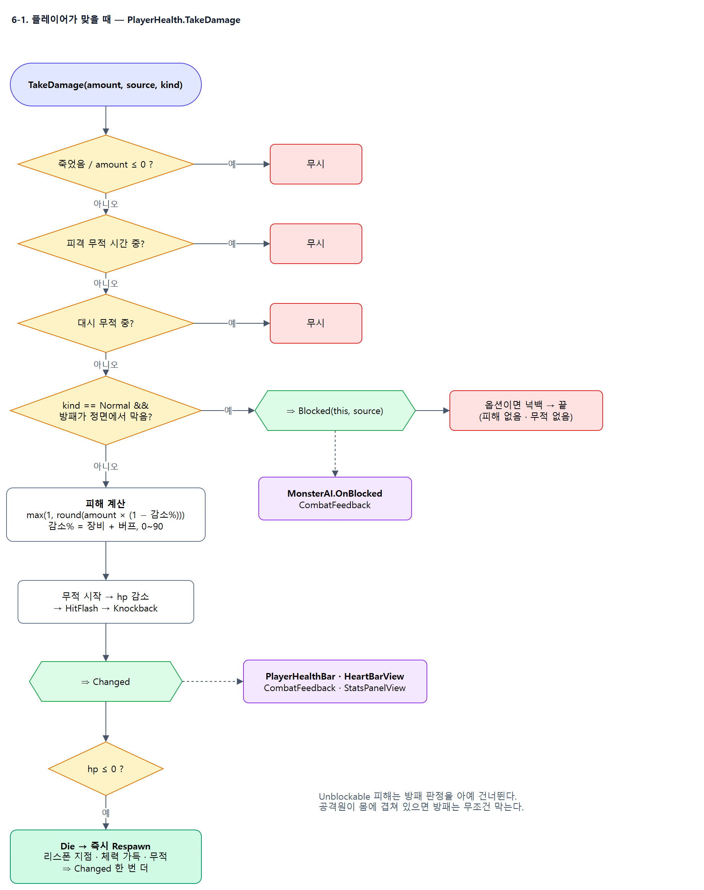

### 6-2. 몬스터가 맞을 때

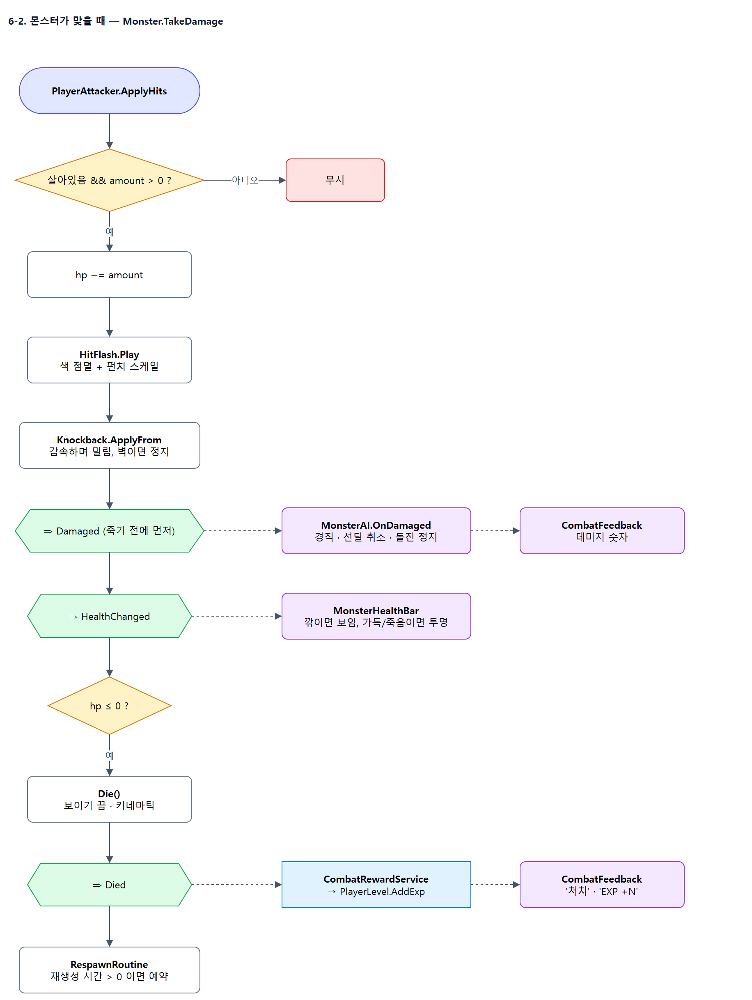

- 몬스터 체력바는 `MonsterHealthBarSpawner.Start`가 씬의 몬스터마다 풀에서 꺼내 붙인다.
- 플레이어 쪽은 `PlayerHealthBar`(지연 바 포함)와 `HeartBarView`(하트 1칸 = N)가 `Changed`를 듣는다.

---

## 7. 능력치 합산

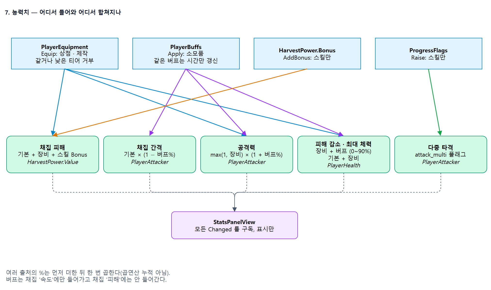

---

## 8. 아이템 · 인벤토리

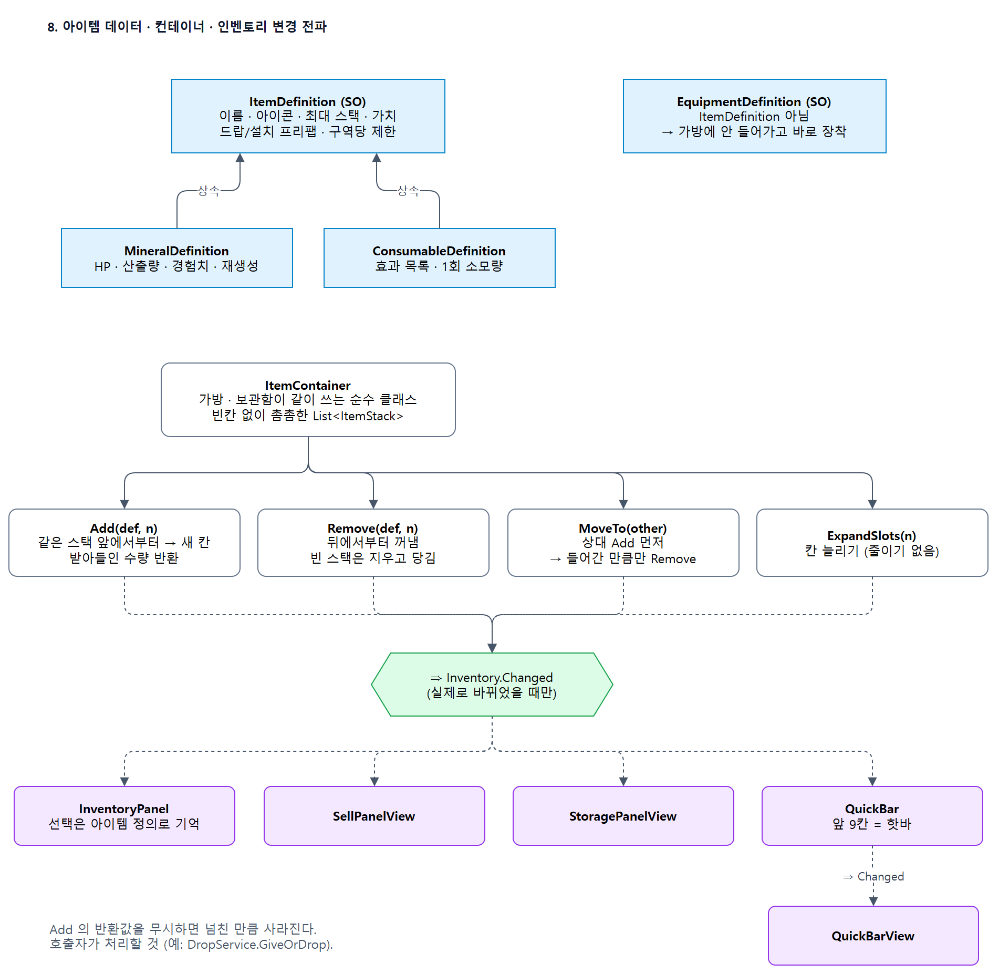

- 핫바는 **인벤토리 앞 9칸**이다. `QuickBar`는 `SelectedIndex` 하나만 가진다.
- 숫자키 → `Select(i)`(바뀔 때만 이벤트), 휠 → `Move(±1)`(순환).

---

## 9. F 상호작용과 스테이션

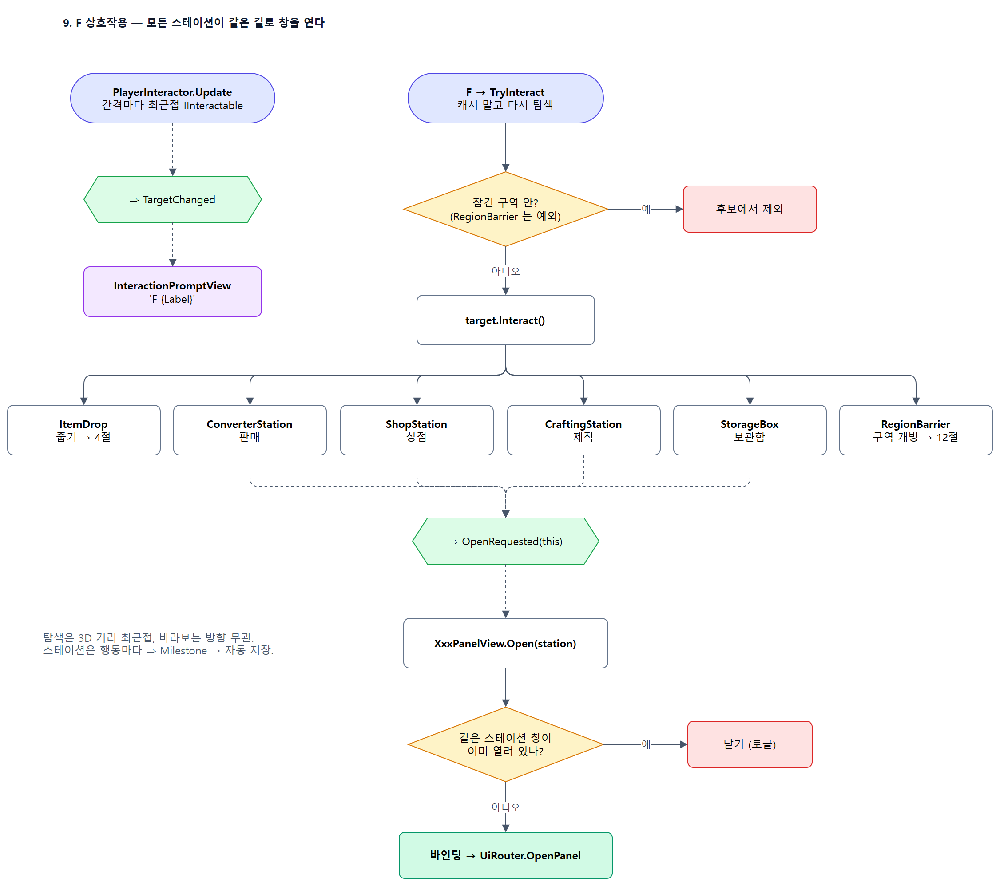

### 9-1 · 9-2. 판매와 상점

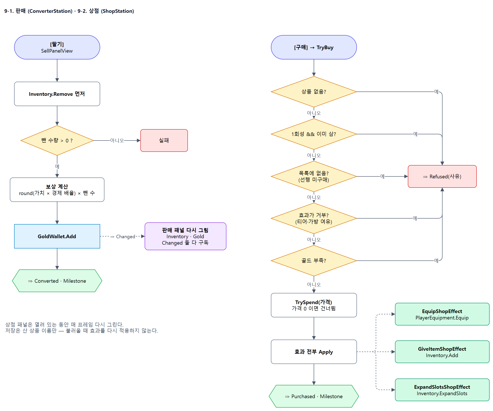

### 9-3 · 9-4. 제작과 보관함

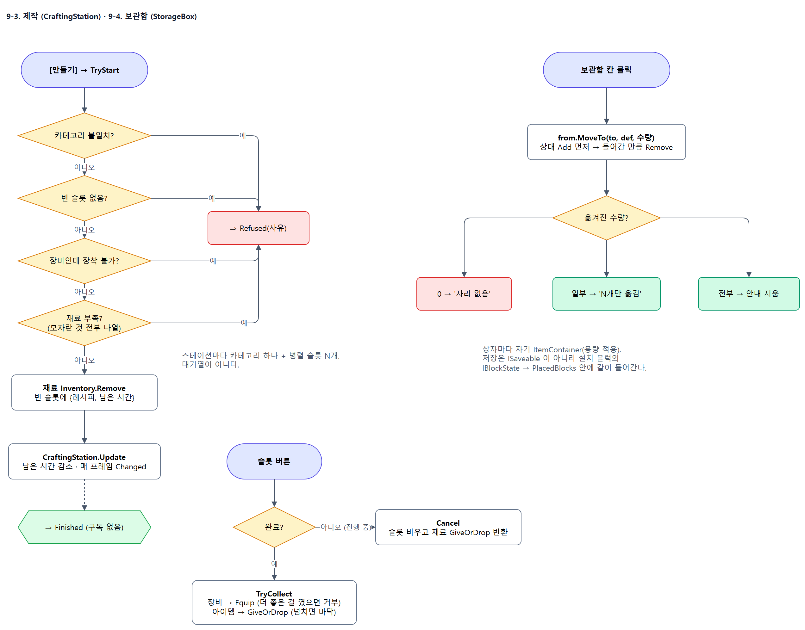

- 제작 저장 키는 `crafting:{카테고리}`. 슬롯별 레시피 이름 + 남은 초(올림).
- 나중에 설치·복원된 보관함은 `PlacedBlocks.Created`를 통해 패널이 `OpenRequested` 구독을 붙인다.

---

## 10. E 키: 소모품 / 블럭 설치

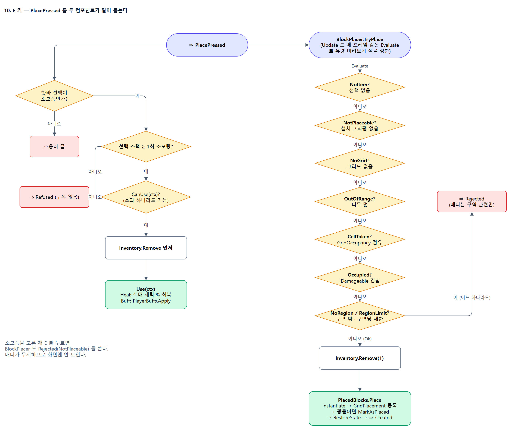

그리드

- `MapGrid.Active` — 칸 ↔ 월드 변환(정적, 지연 탐색).
- `GridPlacement` — `OnEnable`에서 `GridOccupancy`에 등록하고 칸에 맞춰 놓는다. `OnDisable`에서 해제.
- `GridOccupancy` — 칸 → 주인. 나중에 등록한 쪽이 이긴다. 움직이는 몬스터·플레이어는 여기 없다.

---

## 11. 성장: 레벨 · 스킬

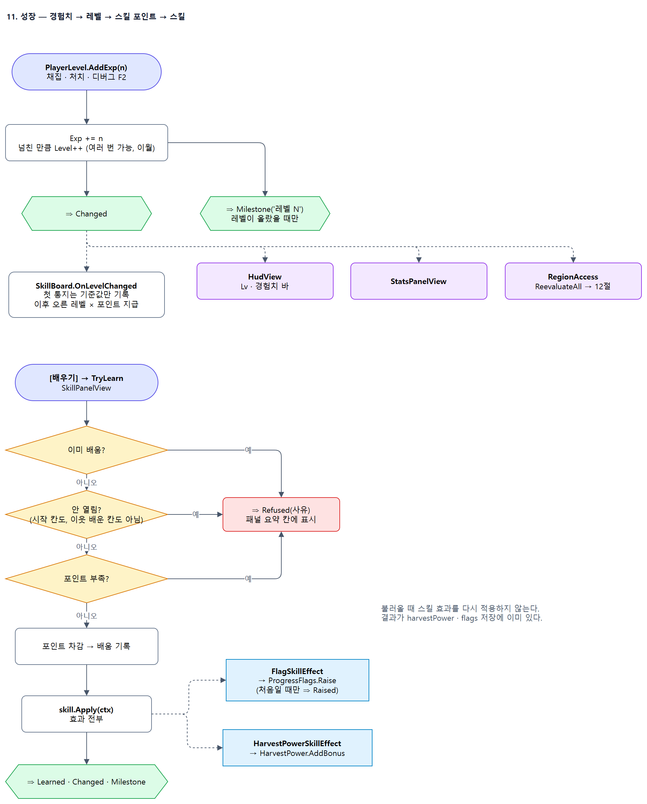

- 스킬이 "열림"인 조건: 시작 칸이거나, 상하좌우에 이미 배운 칸이 있다.
- `ProgressFlags`를 쓰는 곳은 `FlagSkillEffect`뿐, 읽는 곳은 구역 조건과 `PlayerAttacker`(`attack_multi`).

---

## 12. 구역

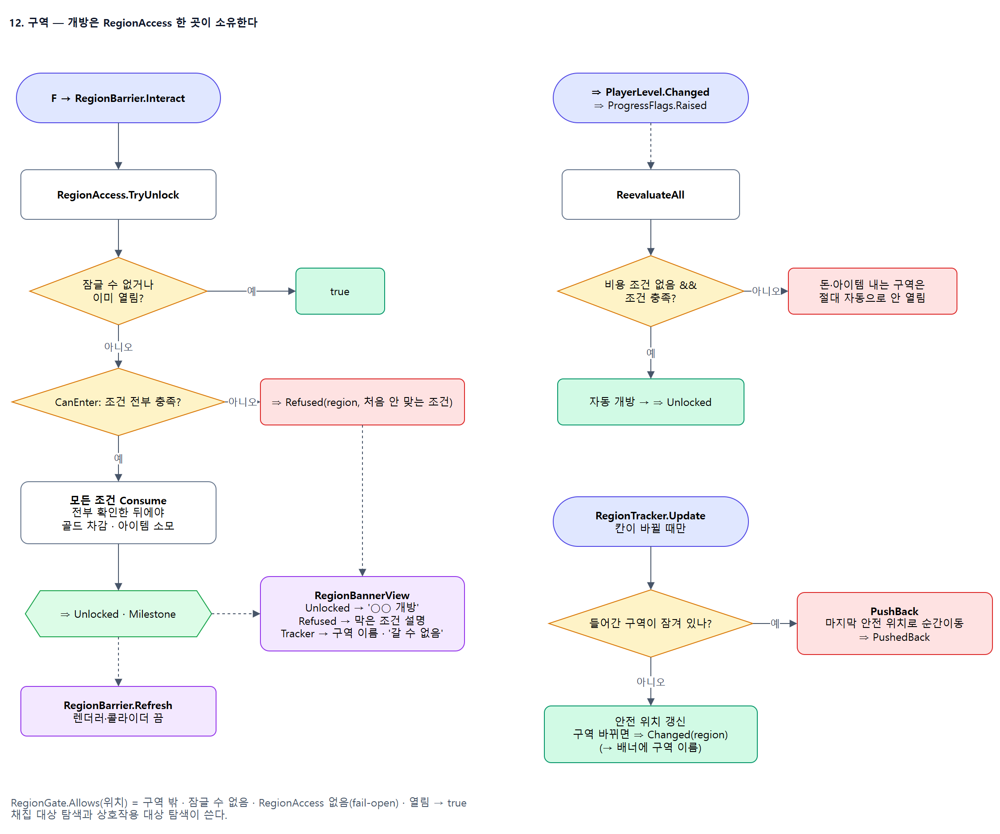

구성

- `RegionDefinition`(SO) — 조건 목록(전부 충족), 영구 개방 여부. 조건이 없으면 항상 열림
- `RegionRequirement`(SO) — Level · Gold · Item · ProgressFlag. 골드·아이템은 `HasCost`면 개방 때 소모
- `RegionVolume` → `RegionMap`(정적, 칸 → 구역)
- `RegionAccess` — **개방 상태의 유일한 주인**
- `RegionTracker` — 현재 구역, 잠긴 구역에서 밀어냄
- `RegionBarrier` — 구역 벽. F로 개방 시도

---

## 13. 저장 / 불러오기

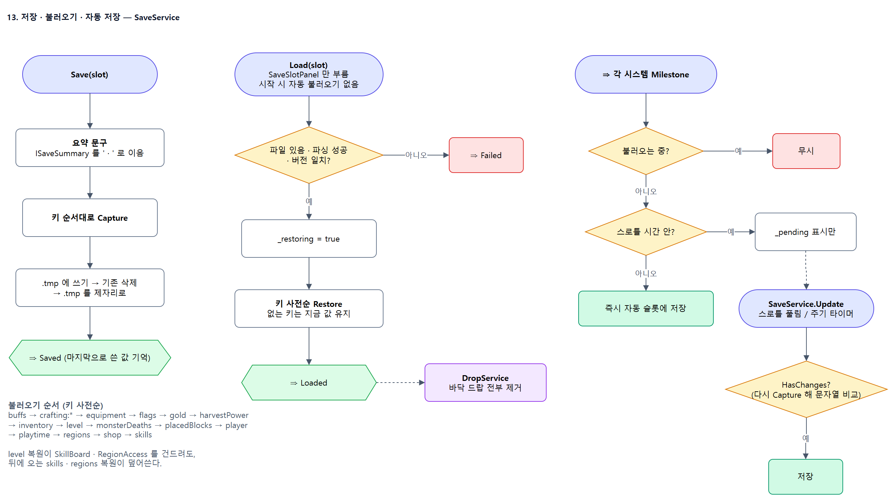

- 각 시스템이 `ISaveable`(`SaveKey` · `Capture` · `Restore`)을 구현한다.
- 에셋은 **이름**으로 저장하고 `SaveCatalog.Find<T>(이름)`으로 되찾는다. 못 찾으면 건너뜀.
- 파일: `persistentDataPath/save_{slot}.json`. 버전이 다르면 **거부**(마이그레이션 없음).
- 저장 안 하는 것: 바닥 드랍, 몬스터 체력·위치, AI 상태.
- `HasChanges`가 문자열 비교라서 `Capture`는 목록을 **정렬**하고, `Playtime`은 **초 단위로 버린다**. 새 `ISaveable`도 같은 상태면 같은 JSON이 나와야 한다.
- 슬롯 창: 빈 슬롯 클릭 = 저장, 찬 슬롯 클릭 = 불러오기 후 창 닫기. 찬 슬롯을 손으로 덮어쓸 방법은 없다. 지우기는 확인 없이 바로.

저장 키 → 클래스

- `buffs` PlayerBuffs · `crafting:{카테고리}` CraftingStation · `equipment` PlayerEquipment
- `flags` ProgressFlags · `gold` GoldWallet · `harvestPower` HarvestPower(Bonus만)
- `inventory` Inventory · `level` PlayerLevel · `monsterDeaths` MonsterDeaths
- `placedBlocks` PlacedBlocks(+ 보관함 내용) · `player` PlayerHealth · `playtime` Playtime
- `regions` RegionAccess · `shop` ShopStation · `skills` SkillBoard

---

## 14. UI 라우팅

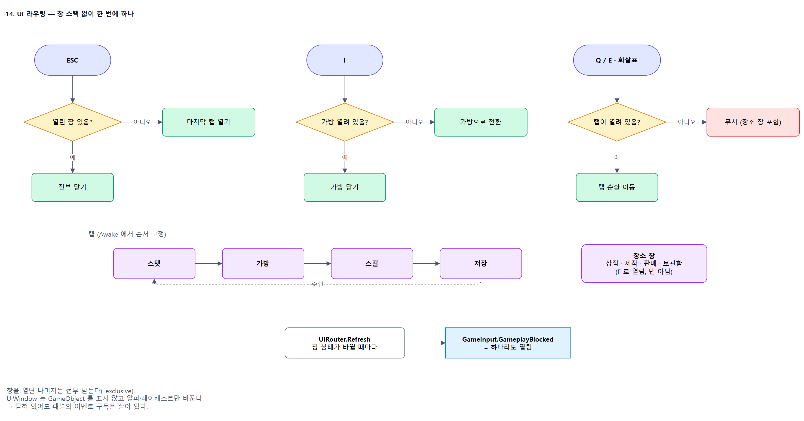

- HUD: `HudView`는 `PlayerLevel.Changed`(Lv + 경험치 바)와 `GoldWallet.Changed`(골드)를 듣는다.
- `StatsPanelView`는 각 시스템의 프로퍼티를 읽기만 한다(표시 전용).

디버그 키 (`DebugTools/DebugCheats.cs`, **빌드에도 포함됨**)

- F1 골드 추가 · F2 경험치 추가(정상 레벨업 경로) · F3 레벨 +1(`Changed`만, 자동 저장 없음)
- F4 모든 광물 즉시 재생성 · F5 스폰 지점으로 순간이동

---

## 15. 오브젝트 풀

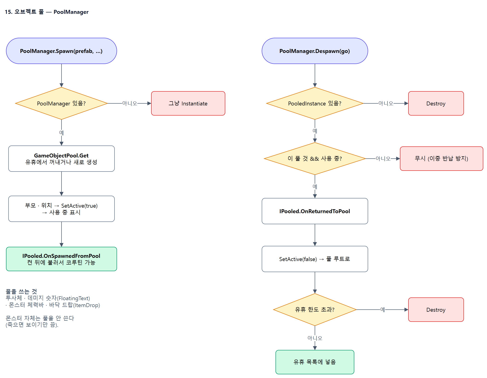

---

## 16. 이벤트 구독 목록

이벤트 → 듣는 쪽

- **PlayerLevel.Changed** → SkillBoard · RegionAccess · HudView · StatsPanelView
- **GoldWallet.Changed** → HudView · SellPanelView
- **Inventory.Changed** → InventoryPanel · SellPanelView · StoragePanelView · QuickBar
- **QuickBar.Changed** → QuickBarView
- **HarvestPower / PlayerEquipment / PlayerBuffs .Changed** → StatsPanelView
- **PlayerHealth.Changed** → PlayerHealthBar · HeartBarView · CombatFeedback · StatsPanelView
- **PlayerHealth.Blocked** → MonsterAI(모든 개체, 자기 공격만 반응) · CombatFeedback
- **PlayerHealth.Died** → RegionCombatReset(싸우던 구역 즉시 초기화)
- **PlayerAttacker.ChargeRatioChanged** → ChargeBarView
- **PlayerInteractor.TargetChanged** → InteractionPromptView
- **MineralNode.Harvested** → HarvestRewardService · CombatFeedback
- **Monster.Damaged** → MonsterAI · CombatFeedback
- **Monster.HealthChanged** → MonsterHealthBar
- **Monster.Died** → CombatRewardService · CombatFeedback
- **DropService.Picked** → PickupAlarmView
- **ConverterStation.Converted** → CombatFeedback
- **스테이션.OpenRequested** → 각 PanelView
- **PlacedBlocks.Created** → StoragePanelView
- **BlockPlacer.Rejected** → RegionBannerView
- **ProgressFlags.Raised** → RegionAccess
- **RegionAccess.Unlocked** → RegionBarrier · RegionBannerView
- **RegionAccess.Refused** → RegionBannerView
- **RegionTracker.Changed / PushedBack** → RegionBannerView · RegionCombatReset(Changed만, 떠난 구역 초기화)
- **SkillBoard.Changed / Refused** → SkillPanelView
- **\*.Milestone** → SaveService(자동 저장)
- **SaveService.Loaded** → DropService
- **SaveService.Saved / Failed** → SaveSlotPanel
- **UiWindow.OpenedChanged** → UiRouter · SaveSlotPanel

**구독자가 아직 없는 이벤트** — 연출·사운드를 붙일 자리

`PlayerDash.Dashed` · `PlayerAttacker.SwingStarted` · `PlayerShield.ShieldingChanged` · `PlayerShield.Blocked` ·
`Monster.Respawned` · `MonsterAI.Telegraphing` · `MonsterAI.StateChanged` · `RegionCombatReset.RegionReset` ·
`BlockPlacer.Placed` · `ConsumableUser.Used / Refused` · `SkillBoard.Learned` · `CraftingStation.Finished`

> 몬스터·광물 이벤트 구독자(`CombatRewardService`, `CombatFeedback`, `MonsterHealthBarSpawner`)는 시작할 때
> `FindObjectsByType`으로 **한 번만** 대상을 모은다. 실행 중에 새로 생긴 몬스터는 따로 붙여야 한다.

---

## 17. 정리하다 발견한 것

### 고친 버그 (2026-10-19 수정 · 플레이테스트 확인)

1. **판매 후 골드 표시가 안 바뀌던 것**
   - 원인: `ConverterStation.Sell`이 가방을 먼저 비우고(→ 패널 다시 그림) 골드를 나중에 줬는데, 판매 패널은 골드 변화를 듣지 않았다.
   - 수정: `SellPanelView`가 `GoldWallet.Changed`도 구독해 다시 그린다.
2. **가격 0인 상품을 살 수 없던 것**
   - 원인: `GoldWallet.TrySpend(0)`이 false라 `ShopStation.TryBuy`가 사유 없이 실패했다.
   - 수정: `TryBuy`가 가격 0이면 차감을 건너뛴다. `TrySpend` 검사는 그대로(`GoldRequirement`도 쓴다).
3. **몬스터가 처음 맞으면 몸 색이 사라지던 것**
   - 원인: `HitFlash.ClearTint`가 PropertyBlock을 통째로 비워 `Monster.Paint`의 `BodyColor`까지 지웠다.
   - 수정: 맞기 직전 블록의 색을 잡아두고 그 색으로 되돌린다. 블록에 색이 없던 광물은 예전처럼 비운다.

### 문서·의도와 코드가 어긋나는 것

- **몬스터 재생성** — `MonsterDeaths` 주석은 재생성을 끈다고 하지만, `MonsterDefinition`의 재생성 시간 기본값이 0이 아니라서 `Monster.Die`가 여전히 재생성을 예약한다.
- **`MonsterSpawner`를 부르는 코드가 없다** — 쓰게 되면 "한 번만 모으는" 구독자들이 새 몬스터를 모른다(보상·팝업·체력바 없음).
- `ItemDrop` 주석은 "드랍은 안 사라진다"인데, `DropService`는 수명이 지나면 회수한다.
- `PlayerActionState` 주석에 "경직(stagger)"이 있지만, 플레이어 쪽에 그런 상태는 없다.
- `HarvestPower` 주석에 상점 효과가 언급되지만, `AddBonus`를 부르는 건 스킬뿐이다.

### 알아두면 좋은 동작

- 창이 열리는 순간 LMB를 누르고 있었다면 `AttackReleased`가 나간다(스윙 여부는 `PlayerAttacker`가 정함).
- 소모품을 고른 채 E를 누르면 `BlockPlacer`도 `Rejected(NotPlaceable)`를 쏜다(배너는 무시).
- 투사체를 방패로 막아도 쏜 몬스터는 경직되지 않는다.
- *(2026-10-26 돌진 폐기 — 아래는 기록)* 돌진 공격은 발사 시점에 후딜이 시작돼서, 후딜 시간이 돌진 시간과 겹친다.
- 플레이어가 죽으면 같은 프레임에 `PlayerHealth.Changed`가 두 번(0 → 가득) 나간다.
- 영구 개방이 꺼진 잠금 구역은 `IsUnlocked`가 항상 false다. 벽이 안 사라지고, 열 때마다 비용을 다시 낸다.
- 불러온 세이브에 없는 구역이 이미 열려 있었다면, 불러와도 그 벽은 다시 나타나지 않는다.
- 불러올 때 `RegionAccess.Restore`가 구역마다 `Unlocked`를 쏴서 "개방" 배너가 뜬다.
- `ProgressFlags.Restore`는 집합을 비우고 다시 채우므로, 인스펙터의 초기 플래그도 저장에 없으면 사라진다.
- 시작할 때 세이브를 자동으로 불러오지 않는다.
